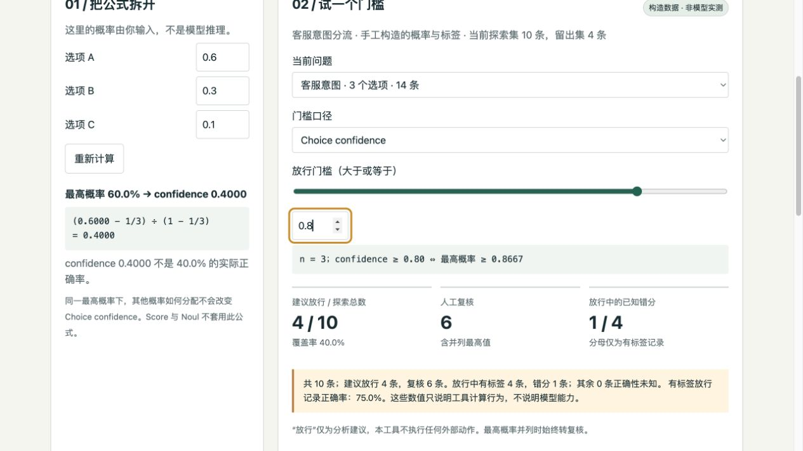

# Choice Confidence Workbench · 置信度工作台
See what each confidence rule releases, holds, or marks wrong — offline. → [Pages demo](https://eric-cqc.github.io/choice-confidence-workbench/dist/Choice-Workbench.html)


[](https://github.com/Eric-Cqc/choice-confidence-workbench/stargazers) · [反馈问题](https://github.com/Eric-Cqc/choice-confidence-workbench/issues/new/choose) · [查看全部作品](https://github.com/Eric-Cqc)

**导入一批分类概率，查看门槛改变后哪些记录需要人工复核，以及已知错误发生在哪里。**

一个离线结果分析工具，面向评估 AI 分类输出的人。提供中文网页和命令行入口，支持逐条检查、探索/留出集分离、报告导出及项目恢复。不调用模型，也不把 confidence 当成真实正确率。

[打开在线工作台](https://eric-cqc.github.io/choice-confidence-workbench/dist/Choice-Workbench.html)



## 先看一个例子

附带样例全部为构造数据。使用 confidence 门槛 0.8 时，探索集 10 条记录中 4 条建议放行、6 条复核；4 条有标签的放行记录中有 1 条错分。门槛升至 0.9 后，仅 1 条放行。这个例子展示覆盖率与复核量的变化，不代表任何真实模型表现。

## 使用

网页：下载仓库后打开 [`dist/Choice-Workbench.html`](dist/Choice-Workbench.html)，载入构造示例，选择问题组，调整门槛，查看记录，再导出报告或保存项目。页面不需要服务器，输入不会自动保存。

命令行需要已有 Node.js（本次核验为 v24.18.0）；不需要安装 npm 依赖：

```sh
node choice.js --input examples/labelled-batch.json --threshold 0.8 --out my-result
node choice.js --input my-result/project.json --threshold 0.9 --out my-next-result
node choice.js --input my-result/project.json --threshold 0.8 --holdout --out my-holdout-result
```

输出包括 `report.md`、`results.json` 和可恢复的 `project.json`。输出目录必须不存在，父目录必须已存在；已有结果不会被覆盖。多问题输入先用 `--list` 列出，再用 `--group 1` 选择；`--metric top` 可按最高概率筛选。

## 输入与解释

支持单个 Choice 对象、`answers` 响应、记录数组和带 `rows` 的项目。字段示例见 [`examples/labelled-batch.json`](examples/labelled-batch.json)。最多 5000 条、5 MiB，每条 2–255 个选项。不同问题或选项集合分别计算；最高概率并列时始终建议复核。未标注记录的对错保持未知。

`confidence = (最高概率 − 1/n) / (1 − 1/n)`。三个选项、最高概率 0.60 时，confidence 为 0.40，不能解释成 40% 或 60% 的实际正确率。门槛按输入数字的最短十进制表示进行 BigInt 分数比较；显示值仍可能有浮点近似。JSON 数字受 binary64 精度限制。

工具不会自动执行业务分流。反复用留出集调参会破坏独立验证意义；小型构造样例不能证明业务收益或模型校准。输入白名单不是自动去敏：标题、记录 ID、标签和备注会保留，公开导出前需要检查。

## 实现与核验

- `src/core.js`：解析、口径隔离、概率与门槛计算。
- `choice.js`：离线 CLI、报告生成和排他输出。
- `src/` / `build.py`：中文网页源文件及标准库构建脚本。
- `tests/`：算法边界、项目恢复、已有文件保护、报告注入与并发输出检查。

```sh
node --test tests/core.test.js
python3 tests/workflow.py
python3 tests/revision.py
```

2026-10-18 对本次公开副本重跑：26 项核心测试、9 项文件流程检查、6 项修订检查通过。另已在浏览器验证样例载入及 0.8 → 0.9 门槛变化，结果与 CLI 一致。浏览器文件导入/导出、手机排版、真实模型推理及真实业务校准尚未核验。

版本 1.0.1。公式与格式参考：[TypeSafe Confidence](https://docs.typesafe.ai/confidence)、[TypeSafe API](https://docs.typesafe.ai/api)。这是独立分析工具，不是 TypeSafe 官方产品；`official-format.json` 是格式示例，不是本工具发起真实调用的结果。

## 使用、反馈与关注

如果这个项目对你有帮助，欢迎点击仓库右上角 **Star**；想跟进版本更新，可用 **Watch → Custom → Releases**。遇到问题请提交复现步骤、预期与实际结果；也欢迎分享希望解决的业务问题。请只使用合成或已脱敏示例，不提交密钥、个人信息或真实客户资料。

查看 [参与说明](CONTRIBUTING.md)。
